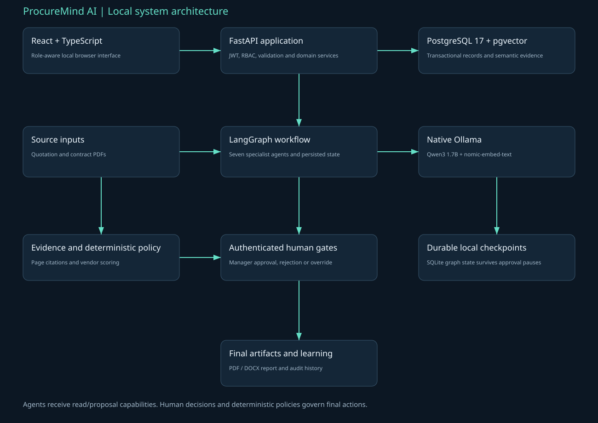

# ProcureMind AI

RFQs, vendors, performance history, quotation/contract uploads, page evidence, local retrieval, seven specialists, deterministic comparison, manager approval/rejection/override and final PDF/DOCX reports.

This is the local portfolio MVP specified by the supplied implementation guide. It uses real Ollama generation and learned embeddings, PostgreSQL/pgvector, FastAPI, LangGraph and React/TypeScript. It runs without paid APIs or cloud services.

## Open the running application

- UI: http://localhost:5173
- API / Swagger: http://127.0.0.1:8000/docs
- Accounts and local password: private `LOGIN.txt` in this project folder.
- Health: http://127.0.0.1:8000/health

## Start and stop

```powershell
cd 'D:\projects\procureMind'
powershell -ExecutionPolicy Bypass -File scripts/Start.ps1
powershell -ExecutionPolicy Bypass -File scripts/Doctor.ps1
powershell -ExecutionPolicy Bypass -File scripts/Stop.ps1
```

Start Docker Desktop before using Start. The script retains database volumes, starts missing native API/UI processes, logs them under storage/logs and prints the interface address. Stop retains the databases and downloaded Ollama models. It only stops processes recorded by the project launcher.

## Fresh setup

Install Python 3.12, Node 24, Docker Desktop with WSL2, native Ollama and Git. Start Docker Desktop. Run:

```powershell
ollama pull qwen3:1.7b
ollama pull nomic-embed-text
cd 'D:\projects\procureMind'
powershell -ExecutionPolicy Bypass -File scripts/Setup.ps1
powershell -ExecutionPolicy Bypass -File scripts/Start.ps1
```

Setup generates .env from .env.example when missing, installs pinned requirements and npm lock-file dependencies, starts pgvector, applies Alembic migrations, builds the UI and seeds synthetic public demonstration data. Do not change the configured demo password after users have been seeded without explicitly updating their password hashes. Existing .env is preserved.

Manual startup: run `docker compose up -d --wait db` in this root, `.venv/Scripts/python.exe -m alembic upgrade head` from backend, then `.venv/Scripts/python.exe -m uvicorn app.main:app --host 127.0.0.1 --port 8000` from backend and `npm run dev` from frontend. Call the venv Python directly; activation is optional.

## Architecture



React -> Vite /api proxy -> FastAPI -> PostgreSQL and local storage. LangGraph specialists call native Ollama and metadata-filtered pgvector retrieval. SQLite persists local graph checkpoints; PostgreSQL holds business records and agent audit history. A human gate controls final decisions.

The 4 GB RTX 3050 uses the guide's Qwen3 1.7B fallback, 4096-token context and serialized model calls. Run one project's analysis at a time for reliable timing. Model/provider code is in backend/app/ai.py.

Ports: database 5432, API 8000, UI 5173; Ollama 11434 is shared. PostgreSQL connections use 127.0.0.1 to avoid the localhost-resolution stall found on this Windows machine.

## Validation performed

- Backend pytest suite: 42 tests in the latest recorded XML; run the Test script for current results.
- Frontend Vitest: 4 tests passed; TypeScript and production build passed.
- Playwright: every page navigated, completed agent run inspected, PDF report downloaded; no JavaScript errors.
- Real local AI workflows: 3 recorded paths, seven agents each. Analysis times: 34.45s, 34.3s, 22.25s.
- Source IDs, statuses and report IDs: [execution results](docs/execution-results.json).
- Browser checks: [browser results](docs/browser-results.json).

```powershell
powershell -ExecutionPolicy Bypass -File scripts/Test.ps1
```

For screenshot/video regeneration, install the bundled Playwright browser with `backend/.venv/Scripts/python.exe -m playwright install chromium`, then run `backend/.venv/Scripts/python.exe scripts/capture_browser.py procureMind` from this root.

E2E scripts perform synthetic business actions and leave auditable demo records. They do not reset or delete prior state. Source-data replay is deterministic; a new test time window prevents unrelated operational scenarios from mixing.

## Interview material and demonstration

- [Detailed Word companion](docs/ProcureMind_Technical_Implementation_Interview_Guide.docx)
- [Detailed PDF companion](docs/ProcureMind_Technical_Implementation_Interview_Guide.pdf)
- [Searchable Markdown companion](docs/ProcureMind_Technical_Implementation_Interview_Guide.md)
- [Guide requirement coverage](docs/GUIDE_COVERAGE.md)
- [Screenshots](docs/screenshots)
- [UI walkthrough video](docs/demo/walkthrough.webm)
- [Original supplied implementation guide](docs/Original_Implementation_Guide.docx)

The companion explains exact technology responsibilities, source modules, database fields, agent contracts, workflow routing, every API, scoring/detection, evidence, security, measured validation, demo steps, troubleshooting and interview answers. Read the limitations before describing accuracy or production scope.

## Security and scope

Passwords use Argon2 and 60-minute JWTs. Role checks run on the server; procurement additionally checks RFQ ownership. Uploads are bounded and source text is escaped. SQLAlchemy parameterizes queries, evidence IDs are validated and model JSON receives one repair retry. Protected audit/evidence tables have database-level immutability triggers. .env, LOGIN.txt, uploads, reports, checkpoints and database volumes are excluded from Git.

The generation model provides validated commentary. Deterministic code owns quotation arithmetic, vendor eligibility/scoring, alert triggers and RCA evidence ranking. Synthetic test success is not a claim of arbitrary-document accuracy or production monitoring. The quotation extractor handles one reconciled labelled digital-PDF item; empty/scanned pages are marked OCR_REQUIRED. Durable worker queues, richer extraction, OCR, SSO, ERP/ITSM connectors and real external notifications are documented extensions.

No agent executes infrastructure commands or issues purchase orders. Operations records an engineer's actual simulated action separately from its proposal and requires a ten-minute healthy evidence window before resolution. The final human decision and original recommendation/hypothesis history remain inspectable.

## Container deployment

See [DEPLOYMENT.md](docs/DEPLOYMENT.md) for the API + production-built frontend + database stack, isolated persistent volumes and reproducible commands. This is local deployment evidence, not a public hosting claim.

## Verified container evidence

Public source: [ProcureMind-AI](https://github.com/yaswanth-pamarthi/ProcureMind-AI). Local Docker workflow evidence: [deployment-results.json](docs/deployment-results.json); real inference workflow: [deployment-workflow-results.json](docs/deployment-workflow-results.json). The containers use production-built frontend assets; hosting remains local. All 79 combined host tests passed again on 2026-10-14. Container tests passed with host-path fixtures skipped, as recorded in the deployment evidence.
