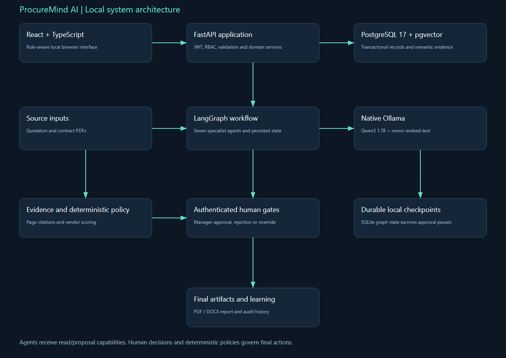
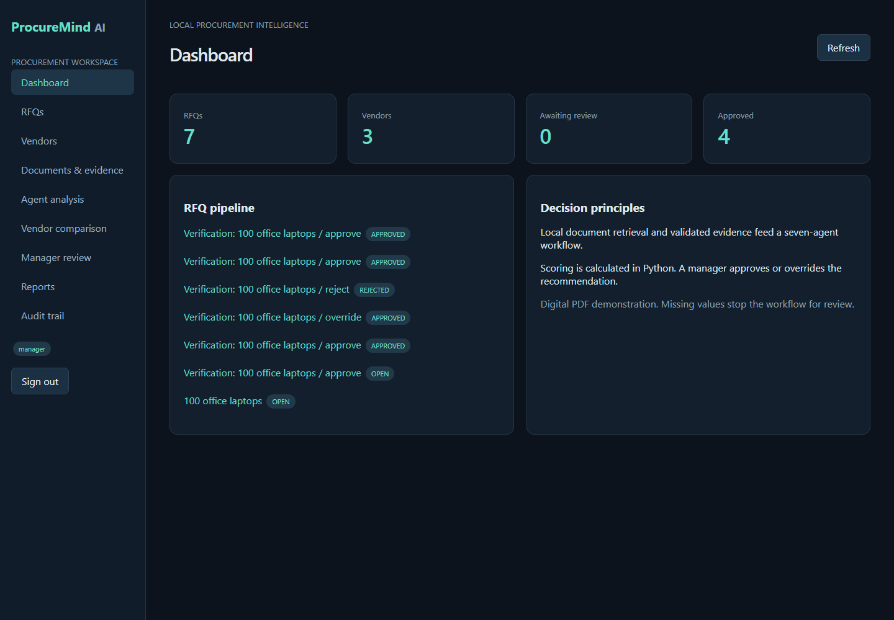
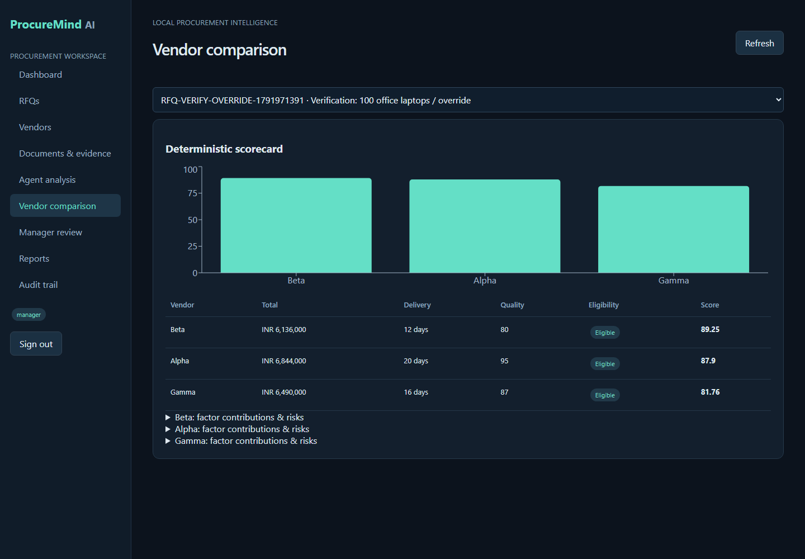
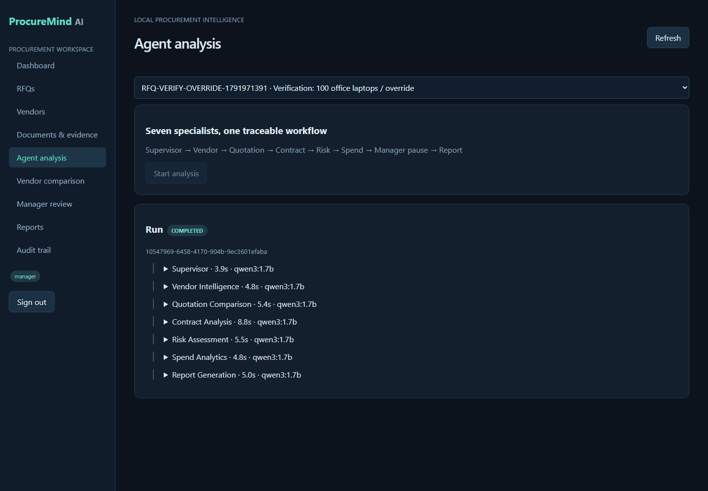
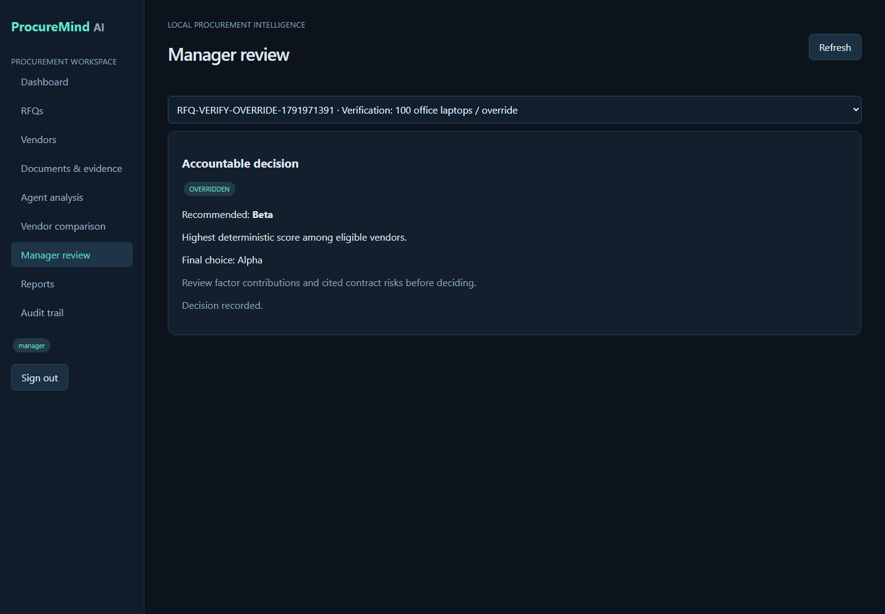

# ProcureMind AI — Technology, Implementation & Interview Guide

Prepared for Venkata Yaswanth Ram Pamarthi from the supplied implementation blueprint, resume context, actual project source and locally recorded test runs. This companion explains what the implementation does and where to inspect it. It describes a local portfolio MVP; claims about production integrations, arbitrary-document accuracy or deployed cloud operations are outside the implemented scope.

Project folder: D:\projects\procureMind. Interface: http://localhost:5173. Swagger: http://127.0.0.1:8000/docs. Local account details are in private LOGIN.txt. Do not copy passwords or .env into interview slides, a repository or screenshots.

## 1. Project summary and business value

An analyst authenticates and creates an RFQ with items, budget, currency, due date and five evaluation weights summing to 100. Vendors are attached as submissions and quotation/contract PDFs are uploaded. Processing extracts page text, creates embeddings, validates commercial fields and persists evidence. The supervisor checks readiness, three specialists analyze vendor/quotation/contract data, Risk aggregates results and scores, and Spend calculates budget indicators. The graph pauses for a manager. Approval, rejection or override is recorded with a reason, then the Report agent resumes and a final report can be generated.

The portfolio value is the complete traceable process: source input, validated data, persisted specialist work, reviewable evidence, human authority and a final downloadable artifact. The supplied resume lists seven agents per project, and all seven are implemented rather than omitting the optional spend/notification specialists.

## 2. Exact local technology stack and responsibility

```
alembic==1.20.0
fastapi==0.143.0
langgraph==1.2.15
pgvector==0.5.1
psycopg==3.3.6
pwdlib==0.3.1
pydantic==2.14.1
PyJWT==2.15.1
pypdf==6.20.1
pytest==9.1.1
python-docx==1.2.0
reportlab==5.0.1
SQLAlchemy==2.1.4
```

Frontend exact installed versions are recorded by package-lock.json. The package manifest declares the requested dependency families; the lock file is used by npm ci to reproduce installed versions. Node on the verified machine is v24.21.0; Python used for the projects is 3.12.10; Docker server is 29.8.2; Ollama is 0.40.4.

### Python 3.12

Purpose: Backend business logic, parsing, orchestration and report generation.

How implemented: Python is pinned to the guide's broad-compatibility version. Each backend has its own virtual environment; startup calls its Python directly so PowerShell activation policy is irrelevant. Domain arithmetic and validation execute in ordinary Python functions rather than model-generated code.

### FastAPI + Pydantic

Purpose: Typed REST endpoints, dependency-based authentication and request/output validation.

How implemented: main.py registers domain routes and exposes Swagger at /docs. Pydantic validates positive values, allowed statuses and required reasons. Authentication and role dependencies run before endpoint logic. BackgroundTasks starts bounded graph work, and the frontend polls persisted run state every two seconds.

### SQLAlchemy + psycopg

Purpose: Parameterized database access and relational source of truth.

How implemented: core.py creates a connection pool and a session factory. models.py defines relational tables and foreign keys. Endpoint transactions commit business changes and audit records together. Connections use 127.0.0.1 with a timeout because localhost resolution stalled on this Windows machine. No endpoint interpolates user input into SQL.

### Alembic

Purpose: Repeatable schema migrations.

How implemented: Revision 001 creates the vector extension and application tables. Revision 002 adds database triggers for append-only evidence or audit history. Setup and Start run alembic upgrade head. Migration order is versioned, so a fresh database can reproduce the schema without manual table creation.

### PostgreSQL 17 + pgvector

Purpose: Relational records and local semantic similarity in one database.

How implemented: Docker Compose runs pgvector/pgvector:pg17 with a named persistent volume and a health check. Embedding columns use Vector(768). Retrieval joins ownership metadata before ordering by cosine distance. Exact search is used at this demonstration scale; HNSW and hybrid ranking remain possible extensions when measurement justifies them.

### LangGraph

Purpose: Explicit specialist workflow, persisted shared state and human approval pauses.

How implemented: workflows.py declares TypedDict state and named specialist nodes. SqliteSaver persists local checkpoints under storage; business records and agent outputs remain in PostgreSQL. interrupt pauses the graph, and Command(resume=...) continues the same run/thread. A checkpoint survives an API restart. The small laptop serializes actual generation calls even where procurement graph specialists fan out logically.

### Ollama + Qwen3 1.7B

Purpose: Local structured language-model explanations.

How implemented: ai.py calls the native Windows Ollama /api/chat endpoint. The RTX 3050 has 4 GB VRAM, so the guide's 1.7B fallback is used with a 4096-token context, temperature zero and bounded output. JSON schema constrains responses and allowed citation IDs. The adapter validates output, retries once with feedback, and stops visibly after a second invalid result.

### nomic-embed-text

Purpose: Local learned embeddings for retrieval.

How implemented: The /api/embed endpoint converts source chunks and search queries to 768-dimensional vectors. Document vectors are persisted rather than recomputed on every question. Generation and embeddings are separate models and responsibilities. An explicitly labelled deterministic test mode is available for isolated testing; verified demo runs use real Ollama inference and nomic embeddings.

### React + TypeScript + Vite

Purpose: Interactive role-aware local interface.

How implemented: The frontend separates an API client from application screens and focused editing/viewer components. Vite proxies /api to the relevant local backend. TypeScript checks the build, browser sessionStorage holds the short-lived JWT, and React renders text with escaping. Forms show loading and server validation errors; report downloads authenticate fetch requests before saving blobs.

### Recharts

Purpose: Dashboard and comparison visualizations.

How implemented: Charts render RFQ/vendor decision information or incident severity counts from API values. They summarize already persisted facts and do not manufacture predictions. The score table still exposes exact numbers and factor contributions; the chart is an aid to explanation rather than the source of the decision.

### pypdf

Purpose: Page-preserving digital PDF extraction.

How implemented: PDF uploads validate extension, MIME, magic bytes, file size and reader compatibility. Extracted page text is split into bounded sections with overlap. Each chunk retains a document ID, page and content hash. Nearly empty pages are labelled OCR_REQUIRED. OCR is an optional path in the source guides, so this implementation makes the missing capability explicit instead of inventing text.

### ReportLab + python-docx

Purpose: Downloadable PDF and Word artifacts.

How implemented: reports.py renders immutable decision facts into readable report artifacts. PDF text is escaped and Word content is generated locally. Report endpoints require the appropriate finalized human workflow and reuse an existing report record on retry. The file download endpoint checks authentication and object access before serving generated names.

### Argon2 + JWT

Purpose: Local authentication and role enforcement.

How implemented: Passwords are hashed with pwdlib Argon2; JWTs carry the user ID and a 60-minute expiry and are verified with a generated local secret. Public registration in procurement creates analysts only. Manager or commander accounts are seeded locally. Database credentials, signing secrets and demo passwords live in .env and private LOGIN.txt, both excluded from version control.

### pytest + Vitest + Playwright

Purpose: Unit, API, frontend network-boundary and browser verification.

How implemented: pytest exercises domain safeguards, authentication and evidence rules. Vitest tests JSON and multipart API-client behavior and error propagation. Playwright signs in, navigates every screen, inspects completed workflows, checks source evidence and downloads reports. Actual API replay scripts additionally exercise the real LLM and PostgreSQL rather than substituting mocked inference.

### Docker Desktop, PowerShell and Git

Purpose: Repeatable local operation and source control.

How implemented: The original development launcher runs the database in Docker and native API/UI/Ollama processes. A separately verified compose.deploy.yml now runs the backend, Nginx-served production frontend and database in containers, with non-root application users, health checks and persistent volumes. Ollama remains a reachable private host service. Git excludes models, .env, uploads, reports, databases and dependency directories. Source repositories are public; this is local container deployment, not public cloud hosting.

## 3. Architecture and important data boundaries

The browser calls a localhost Vite proxy, which forwards authenticated requests to one FastAPI application. Relational business records and 768-dimensional vectors are persisted in PostgreSQL. Uploaded sources and generated reports use controlled storage directories. Ollama runs natively with GPU inference. LangGraph checkpoint files are local SQLite state; they complement, rather than replace, PostgreSQL business records.

```
flowchart LR
      Browser[React TypeScript UI] --> API[FastAPI role and object checks]
      API --> DB[(PostgreSQL 17 + pgvector)]
      API --> Files[Local uploads and reports]
      API --> Graph[LangGraph specialist workflow]
      Graph --> Ollama[Native Ollama Qwen3 1.7B]
      Graph --> Checkpoint[(Durable SQLite checkpoints)]
      Ollama --> Evidence[Validated JSON and allowed evidence IDs]
      Graph --> Human[Authenticated human review]
      Human --> Final[Final report with audit history]
```



Generation can explain supplied evidence, but deterministic services own authoritative calculations and lifecycle transitions. A source document/log is treated as untrusted data. A retrieved chunk supplies content and provenance, not instructions. Approval is an application record that resumes a particular graph thread; the model cannot self-approve or bypass the role dependency.

## 4. Source code walkthrough

| Backend module | What to explain |
| --- | --- |
| core.py | Settings, paths, SQLAlchemy engine/session, password hashing, JWT, current user, role and ownership dependencies, audit utility. |
| models.py | Tables, foreign keys, unique constraints, persisted business state, source evidence, agent runs/outputs and approval/report records. |
| schemas.py | Typed request and domain contracts, positive-value constraints, allowed decisions/statuses and mandatory business fields. |
| ai.py | Embedding and structured-generation HTTP clients, GPU call serialization, citation schema, bounded evidence packet and one repair attempt. |
| workflows.py | Shared state, specialist nodes, persistent graph compilation, interrupt/resume handling, run status and visible failures. |
| reports.py | Escaped local PDF and DOCX generation from persisted human decisions and facts. |
| main.py | REST routes, permissions, uploads, business transaction boundaries, background execution, report/download policy and health endpoint. |
| documents.py | PDF allowlist, upload deduplication, page text, chunks, embeddings, validated commercial extraction, exact contract findings and filtered retrieval. |
| scoring.py | Eligibility guard, currency/positive-value checks, normalization, factor contribution and deterministic rank. |

Frontend source begins at src/main.tsx. App.tsx provides the role-aware pages, api.ts owns authenticated JSON/multipart requests and blob downloads, and style.css defines the responsive local interface. Procurement also has PdfViewer.tsx and RFQEditor.tsx; operations has RuleManager.tsx. Tests and scripts demonstrate these modules through public APIs rather than editing the database to manufacture a successful path.

## 5. Database model and persisted evidence

| Actual table | Persisted fields |
| --- | --- |
| users | id, email, password_hash, role |
| activity_logs | id, actor_id, action, entity_id, metadata_json, timestamp |
| vendors | id, name, country, category, compliance_status, mandatory_failure, risk_level |
| vendor_performance | id, vendor_id, metric, value, period, source |
| rfqs | id, owner_id, number, title, budget, currency, due_date, status, weights_json, created_at |
| rfq_items | id, rfq_id, description, quantity, unit, target_price |
| vendor_submissions | id, rfq_id, vendor_id, status, total, currency, extracted_json |
| quotation_items | id, submission_id, rfq_item_id, unit_price, tax, delivery_days |
| documents | id, submission_id, type, original_name, path, hash, parse_status, metrics_json |
| document_chunks | id, document_id, page_start, page_end, section, text, text_hash, embedding |
| contract_findings | id, document_id, evidence_chunk_id, category, severity, finding, payload_json |
| agent_runs | id, entity_id, workflow, status, model, started_at, completed_at, error |
| agent_outputs | id, run_id, agent_name, schema_version, prompt_version, started_at, completed_at, payload_json, inputs_json, model_json |
| vendor_scores | id, run_id, submission_id, factor, raw, normalized, weight, contribution |
| recommendations | id, rfq_id, run_id, preferred_vendor_id, final_vendor_id, status, payload_json |
| approvals | id, recommendation_id, actor_id, decision, reason, timestamp |
| reports | id, rfq_id, recommendation_id, files_json, generated_at |

Foreign keys link business objects to their evidence and human actors. Unique constraints enforce source deduplication and one decision per recommendation/proposal. PostgreSQL JSON fields preserve structured specialist/domain payloads, while explicit columns retain identities and lifecycle status for queries. Vector columns contain learned nomic embeddings. Audit/evidence triggers reject UPDATE or DELETE on protected records even if a caller bypasses the web interface.

## 6. Complete process, node contracts and failure routing

```
import sqlite3, threading
from typing import TypedDict
from sqlalchemy import select
from langgraph.graph import StateGraph, START, END
from langgraph.types import interrupt, Command
from langgraph.checkpoint.sqlite import SqliteSaver
from .core import ROOT, Session, uid, now
from .models import (
    RFQ,
    Submission,
    Vendor,
    Performance,
    Document,
    Finding,
    Run,
    Output,
    Recommendation,
    Score,
    Chunk,
)
from .ai import commentary
from .scoring import score_vendors, vendor_risk
from .documents import retrieve
```

| Agent | Input contract | Output/failure rule |
| --- | --- | --- |
| Supervisor | RFQ, submissions and document readiness | Validated plan; NEEDS_INPUT for missing mandatory data |
| Vendor Intelligence | Vendor master and sourced performance | Quality/reliability and compliance facts; missing history remains missing |
| Quotation Comparison | Validated commercial quotations with evidence | Commercial comparison and citation set; mixed currencies stop |
| Contract Analysis | RFQ-filtered contract chunks and exact findings | Clause risks, missing clauses and cited retrieval; no unsupported material finding |
| Risk Assessment | Validated vendor/quotation/contract information | Eligibility, deterministic factors, risk register and preferred eligible vendor |
| Spend Analytics | RFQ budget and current vendor totals | Variance/savings; unavailable historical forecasts remain absent |
| Report Generation | Preserved recommendation and manager decision | Final report model without changing scores or original recommendation |

Every completed specialist persists its prompt version, schema version, evidence IDs, model metadata, structured payload, start and end time. Generation output is validated before the node output is considered successful. A second invalid response records a FAILED run. Missing prerequisites generate a visible NEEDS_INPUT or failure message and allow the user to supply the required data. Human review nodes use persisted graph interruption rather than a frontend-only toggle.

The graph fans out Vendor, Quotation and Contract work after Supervisor, then joins all three at Risk. A model-call lock serializes GPU generation on the 4 GB device. Risk and Spend finish before the manager pause; Report resumes after the decision. The independent branches update different state keys, so specialist state is explicit and merges without last-write-wins ambiguity.

## 7. Authoritative domain logic and reproducibility

```
from decimal import Decimal, ROUND_HALF_UP

RISK_MATRIX = {
    "low": {"low": "low", "medium": "low", "high": "medium"},
    "medium": {"low": "low", "medium": "medium", "high": "high"},
    "high": {"low": "medium", "medium": "high", "high": "critical"},
}


def risk_level(likelihood, impact):
    return RISK_MATRIX[likelihood][impact]


def vendor_risk(row):
    likelihood = (
        "high"
        if row["penalty"] >= 30
        else "medium"
        if row["penalty"] > 0 or row["compliance"] == "conditional"
        else "low"
    )
    if row.get("profile_risk") == "high":
        likelihood = "high"
    impact = "high" if row["penalty"] >= 30 or row["mandatory_failure"] else "medium"
    return {"likelihood": likelihood, "impact": impact, "level": risk_level(likelihood, impact)}


def score_vendors(rows, weights):
    if not rows:
        raise ValueError("At least one submission is required")
    if len({r["currency"] for r in rows}) != 1:
        raise ValueError("Mixed currencies require an explicit conversion policy")
    if any(r["total"] <= 0 or r["delivery_days"] <= 0 for r in rows):
        raise ValueError("Price and delivery must be positive")
    if any(r.get("quality") is None for r in rows):
        raise ValueError("Missing quality history requires manual review")
    if (
        set(weights) != {"price", "quality", "delivery", "compliance", "contract"}
```

### How is price normalized?

For eligible submissions using the same currency, price_score = 100 × minimum eligible price ÷ vendor price, capped at 100. The application rejects zero/negative values and mismatched currencies. Delivery uses the analogous minimum-days ratio. Quality comes from sourced performance records, compliance maps to defined values, and contract score subtracts explicit risk penalties. Each factor's raw value, normalized value, configured weight and contribution is stored, so another engineer can reproduce the total.

### Why can the cheapest vendor lose?

Price is only 30 percent of the default score. Historical quality, delivery, compliance and contract risk contribute the rest. A mandatory compliance failure excludes a vendor from recommendation even if its numeric score is high. In the prepared data Beta still wins narrowly under the default weights, but carries risky termination and advance-payment findings. The manager sees those evidence-linked risks and can override to an eligible alternative with an accountable reason.

### How do you handle missing quality history?

The Vendor specialist marks unavailable history as missing, and scoring refuses to invent a rating. The workflow records the failure and returns the RFQ to a state where the analyst can add sourced performance data and rerun. This is preferable to silently inserting a neutral score that changes the vendor order. A future policy could explicitly allow an agreed prior or remove/reweight the factor, but that would need a documented decision policy.

### How are quotation values extracted?

pypdf extracts page text and a validated labelled-field parser maps currency, quantity, unit price, tax, total, delivery days, payment terms and warranty months for the prepared digital quotation format. Each field retains the matching excerpt and exact source chunk/page. Pydantic validates positivity and reconciles quantity × unit price × tax multiplier with the total. The current extractor supports one reconciled line item per quotation; arbitrary vendor layouts and multiline item extraction are identified extensions.

### How are contract findings grounded?

The commercial rule catalogue identifies risky short termination, liability exclusions, advance payments and explicit data-protection exclusions. Each persisted finding links to an exact matched excerpt in a current document chunk and supplies category, severity, business impact, mitigation, confidence and risk penalty. The Contract specialist also retrieves relevant clauses through pgvector and lists expected clauses not located in the supplied contract. Missing-clause notes are not treated as proof that a protection exists elsewhere.

### Explain the human approval checkpoint.

The graph interrupts after the recommendation and spend analysis. Only a manager can submit a decision, and a nontrivial reason is mandatory. An override must name an eligible vendor in the same comparison. The original preferred_vendor_id and scorecard remain unchanged; final_vendor_id records the human choice. The same run resumes through Report Generation, and report generation is blocked until the manager decision and resumed workflow complete.

## 8. REST API catalogue and how the UI uses it

| Actual endpoint | Responsibility |
| --- | --- |
| GET /health | Health |
| POST /auth/login | Authenticate |
| POST /auth/register | Register |
| GET /vendors | Vendors |
| POST /vendors | Create Vendor |
| POST /vendors/{id}/performance | Performance |
| GET /vendors/{id}/performance | History |
| PATCH /vendors/{id} | Update Vendor |
| GET /rfqs | Rfqs |
| POST /rfqs | Create Rfq |
| GET /rfqs/{id} | Rfq Detail |
| PATCH /rfqs/{id} | Update Rfq |
| PATCH /rfqs/{id}/status | Status |
| POST /rfqs/{id}/submissions | Add Submission |
| POST /submissions/{id}/documents | Upload Document |
| POST /documents/{id}/process | Process Document |
| GET /documents/{id}/findings | Findings |
| GET /documents/{id}/file | Document File |
| GET /rfqs/{id}/evidence | Evidence |
| POST /rfqs/{id}/analysis-runs | Analysis |
| GET /analysis-runs/{id} | Run Detail |
| GET /rfqs/{id}/comparison | Comparison |
| POST /recommendations/{id}/decision | Decision |
| POST /rfqs/{id}/reports | Report |
| GET /reports/{id}/{format} | Download Report |
| GET /activity | Activity |

The generated Swagger schema is the executable API contract. Use the Authorize button with a login token to exercise protected routes. The frontend uses the same public endpoints and displays server validation errors. Manager/commander-only controls are hidden or disabled appropriately, but security is enforced again by the backend; changing browser JavaScript cannot grant a privileged role.

## 9. Windows setup, execution and repeatable operations

```
cd D:\projects\procureMind
powershell -ExecutionPolicy Bypass -File scripts\Setup.ps1
powershell -ExecutionPolicy Bypass -File scripts\Start.ps1
powershell -ExecutionPolicy Bypass -File scripts\Doctor.ps1
powershell -ExecutionPolicy Bypass -File scripts\Test.ps1
```

Prerequisites are Python 3.12, Node 24, Docker Desktop with a running WSL2 engine, and native Ollama. Pull qwen3:1.7b and nomic-embed-text before seeding. Setup retains an existing .env, installs pinned backend/frontend dependencies, starts the database, upgrades migrations, builds the frontend and seeds synthetic data. Start launches missing native API/UI processes in hidden windows and records logs. Stop stops only recorded project launcher processes and retains database volumes and models.

Both projects can run together without port collisions. Procurement uses database 5432, API 8000 and UI 5173. Operations uses database 5433, API 8001 and UI 5174. Ollama is shared at 11434. For stable timing, run only one project's model analysis at a time and avoid concurrent embedding jobs. A model fitting on disk does not guarantee spare VRAM; the fallback and short context keep the demo practical.

For manual startup, run docker compose up -d --wait db in the root; run backend/.venv/Scripts/python.exe -m uvicorn app.main:app --host 127.0.0.1 --port 8000 from backend; run npm run dev from frontend. Environment examples contain placeholders, while scripts/configure.py generates local random secrets. The private LOGIN.txt lists the actual local accounts without exposing passwords in source or screenshots.

## 10. Measured validation and acceptance evidence

Public source repository: https://github.com/yaswanth-pamarthi/ProcureMind-AI. Verified Docker interface: http://localhost:15173. API documentation: http://localhost:15173/api/docs. Deployment checks include three healthy containers, production-built frontend assets, real inference workflow completion and report download. See docs/DEPLOYMENT.md for clean-checkout commands and docs/deployment-results.json for evidence. Public cloud hosting remains outstanding.

```
docker compose -f compose.deploy.yml up -d --build --wait
docker compose -f compose.deploy.yml exec api python /app/scripts/seed.py
docker compose -f compose.deploy.yml exec api python -m pytest -q
```

Container pytest passed 39 tests with 3 host-path fixtures skipped. Those fixtures pass in the full native test suite; the combined host backend/frontend total is 79 passing tests. Container evidence does not inflate that count.

| Executed path | Status | Agents | Analysis seconds | Model |
| --- | --- | --- | --- | --- |
| override | OVERRIDDEN | 7 | 34.45 | qwen3:1.7b |
| reject | REJECTED | 7 | 34.3 | qwen3:1.7b |
| approve | APPROVED | 7 | 22.25 | qwen3:1.7b |

Procurement acceptance tests cover valid arithmetic and weights, zero/missing values, mixed currencies, hard eligibility, three labelled PDFs, exact contract excerpts, role permissions, immutable audit history and malformed model output repair. Operations tests cover three parsers, malformed-line retention, secret redaction, UTC timestamps, canonical hashing, burst/ratio/latency thresholds, evidence ranking, text-only command risk flags and immutable incident evidence/timeline.

| Restart test | Before | After | Agents | Passed |
| --- | --- | --- | --- | --- |
| procureMind | WAITING_APPROVAL | COMPLETED | 7 | True |

The frontend test suite checks authenticated JSON requests, multipart boundary handling, visible server errors and read-only GET behavior. Playwright verifies every page, completed workflow visibility and an authenticated report download. Browser screenshots and video artifacts are stored under docs/screenshots and docs/demo. The real API execution-results.json contains run/entity/report IDs so each measured result can be inspected in the application.

```
{
  "browser": "Playwright Chromium",
  "pages": 9,
  "checks": [
    "Navigated Dashboard",
    "Navigated RFQs",
    "Navigated Vendors",
    "PDF page evidence viewer rendered",
    "Navigated Documents & evidence",
    "Seven-agent completed workflow visible",
    "Navigated Agent analysis",
    "Navigated Vendor comparison",
    "Navigated Manager review",
    "Browser PDF report download passed",
    "Navigated Reports",
    "Navigated Audit trail"
  ],
  "javascript_errors": [],
  "passed": true
}
```

Prepared-data quotation fields and high-risk excerpt citations are validated separately from model commentary. Valid schema and valid citation IDs do not by themselves prove every generated sentence correct. RCA scores order evidence-backed hypotheses and do not claim statistical calibration. Timing numbers are measured on this Windows laptop after setup; a cold model load or another GPU workload can increase latency.

## 11. Requirement-by-requirement implementation traceability

| Guide ID | Implemented process | Source location | Verification |
| --- | --- | --- | --- |
| FR-01 | Authentication, analyst/manager roles | core.py; main.py /auth/login and /auth/register | test_api.py role tests; browser login |
| FR-02 | Validated RFQ create/update and lifecycle | schemas.py RFQIn; main.py RFQ routes; RFQEditor.tsx | Weight-sum tests; UI RFQ editor; analysis/decision lifecycle |
| FR-03 | Vendor master and sourced history | models.py Vendor/Performance; /vendors and /performance | Three seeded vendors; quality missing-data guard |
| FR-04 | Quotation/contract PDF uploads | documents.py validate_pdf/upload; /submissions/{id}/documents | Spoofed-file tests; three quotation + three contract PDFs |
| FR-05 | Structured extraction with evidence | documents.py process; schemas.py Quotation | 24 labelled commercial fields; arithmetic and page evidence tests |
| FR-06 | Clause findings and missing clauses | documents.py clause catalogue; workflows.py Contract Analysis | Exact excerpt/chunk/page validity tests; Beta risks visible |
| FR-07 | Eligible comparison and contributions | scoring.py; models.py Score; comparison endpoint | Deterministic repeatability, zero-value/mixed-currency/ineligible tests |
| FR-08 | Recommendation with rationale/alternatives | workflows.py Risk; Recommendation model | Three real AI workflow runs and persisted scorecards |
| FR-09 | Manager approval/rejection/override | main.py decision; interrupt/Command in workflows.py | All three golden decisions; unauthorized analyst forbidden |
| FR-10 | Final PDF/DOCX report | reports.py; report/download endpoints | Actual authenticated API and browser downloads; repeat report ID |
| FR-11 | Inspectable agent execution | Run/Output models; /analysis-runs/{id}; UI timeline | Seven outputs with model/prompt/schema/timestamps per completed path |
| FR-12 | Search and source-page inspection | documents.py retrieve; PdfViewer.tsx; evidence endpoint | Metadata-filtered pgvector retrieval and embedded source PDF viewer |

The source guide's installation plan, concept catalogue, execution schedule and interview prompts are engineering guidance, not claims of production certification. The implemented core process is demonstrated by public API replay. Optional OCR, statistically trained anomaly detection, real notifications, ERP/ITSM/SSO integration and autonomous infrastructure actions remain outside the original local-MVP acceptance boundary. The concrete single-item quotation extractor is an additional prepared-format limitation and is stated explicitly.

## 12. Concept catalogue mapped to the implementation

### Multi-agent orchestration

Meaning: A workflow in which specialized nodes perform bounded responsibilities and communicate through shared state.

Why this method is selected: Specialization makes outputs testable and explainable. A graph also supports retries, branches and human review better than one long prompt.

Trade-off / alternative: A single prompt is faster to prototype but becomes difficult to test, observe and revise.

Implementation reference: Inspect the domain modules, graph outputs and evidence controls described above; the local-MVP trade-off is preserved.

### State graph

Meaning: A directed workflow made of state, nodes and edges.

Why this method is selected: Explicit state prevents hidden data passing and makes each transition inspectable. LangGraph specifically models workflows through state, nodes and edges [R2].

Trade-off / alternative: A sequence of ordinary functions is simpler, but conditional re-analysis and approval loops become harder to maintain.

Implementation reference: workflows.py StateGraph, SqliteSaver and interrupt/resume

### Supervisor pattern

Meaning: A coordinator selects and sequences specialist work without doing every analysis itself.

Why this method is selected: It centralizes workflow policy while keeping domain prompts small.

Trade-off / alternative: Uncontrolled agent-to-agent delegation can be more flexible but less predictable and more expensive.

Implementation reference: workflows.py supervisor prerequisite checks

### Fan-out / fan-in

Meaning: Independent tasks branch from one state and later merge.

Why this method is selected: It reflects real separation of concerns. On the laptop, logical parallelism can execute sequentially to control GPU memory.

Trade-off / alternative: True concurrent calls reduce latency on a server but can overload a small laptop GPU.

Implementation reference: procurement specialist branch edges and Risk join, with serialized GPU calls

### Structured output

Meaning: The LLM must return a validated schema rather than unrestricted prose.

Why this method is selected: Validation catches missing fields and enables direct storage, scoring and UI rendering.

Trade-off / alternative: Free-form prose is easier to generate but unreliable for downstream automation.

Implementation reference: Inspect the domain modules, graph outputs and evidence controls described above; the local-MVP trade-off is preserved.

### Retrieval-Augmented Generation (RAG)

Meaning: Relevant document chunks are retrieved and supplied to the model at answer time.

Why this method is selected: RAG grounds findings in uploaded documents and avoids sending entire PDFs into a small model context.

Trade-off / alternative: Fine-tuning is unnecessary for project-specific documents and requires more data and compute.

Implementation reference: Inspect the domain modules, graph outputs and evidence controls described above; the local-MVP trade-off is preserved.

### Embeddings

Meaning: Dense numerical vectors represent semantic meaning for similarity search.

Why this method is selected: A small Apache-licensed embedding model runs locally and separates retrieval from the generation model.

Trade-off / alternative: Keyword search is useful as a hybrid fallback but misses paraphrased clauses.

Implementation reference: ai.py embed and the pgvector chunk models

### Deterministic scoring

Meaning: A fixed mathematical function calculates the final numeric score.

Why this method is selected: The LLM explains and extracts; deterministic code calculates. This prevents arithmetic drift and improves auditability.

Trade-off / alternative: LLM-only scoring appears intelligent but can change between runs and cannot be independently verified.

Implementation reference: scoring.py score_vendors and stored Score factors

### Human-in-the-loop (HITL)

Meaning: A person reviews and authorizes a consequential action.

Why this method is selected: Procurement decisions have financial and legal consequences. LangGraph highlights human oversight as a core workflow capability [R1].

Trade-off / alternative: Autonomous selection is inappropriate for an interview MVP and weakens accountability.

Implementation reference: authenticated manager decision and persisted interrupt checkpoint

### Evidence provenance

Meaning: Every claim records where its support came from.

Why this method is selected: Provenance allows reviewers to verify the recommendation and is essential for trustworthy document AI.

Trade-off / alternative: A simple answer without citations is faster but cannot be audited.

Implementation reference: document/page/chunk/excerpt fields or frozen event IDs

### Confidence calibration

Meaning: The system distinguishes confidence from truth.

Why this method is selected: This encourages conservative behavior when documents are incomplete.

Trade-off / alternative: A numeric probability would look precise but is not statistically calibrated in this MVP.

Implementation reference: Inspect the domain modules, graph outputs and evidence controls described above; the local-MVP trade-off is preserved.

### Idempotency

Meaning: Repeating an operation does not create duplicate business effects.

Why this method is selected: Retries are common in AI workflows. Idempotency makes failure recovery safe.

Trade-off / alternative: Without it, a retry can duplicate chunks, reports or audit events.

Implementation reference: Inspect the domain modules, graph outputs and evidence controls described above; the local-MVP trade-off is preserved.

### Audit trail

Meaning: Immutable records show who did what and when.

Why this method is selected: It demonstrates enterprise governance and supports interview questions about accountability.

Trade-off / alternative: Only application console logs are insufficient because they are not tied to business entities.

Implementation reference: Inspect the domain modules, graph outputs and evidence controls described above; the local-MVP trade-off is preserved.

### Local inference

Meaning: Models run on the user's device rather than a paid API.

Why this method is selected: It satisfies zero-cost operation, keeps sample documents local and demonstrates model-provider abstraction.

Trade-off / alternative: Hosted models may produce better answers but introduce cost, keys and network dependency.

Implementation reference: Inspect the domain modules, graph outputs and evidence controls described above; the local-MVP trade-off is preserved.

## 13. Three-minute interview demonstration

1. Sign in as analyst and show the RFQ dashboard.

2. Open the prepared 100-laptop RFQ, three vendors and processed quotation/contract PDFs.

3. Open a quotation field and Beta contract risk, then inspect its source page and excerpt.

4. Start analysis or open a measured completed run; show seven specialist outputs and the manager checkpoint.

5. Explain factor contributions and hard eligibility in the vendor comparison.

6. Sign in as manager and show approval, rejection or override with a mandatory reason.

7. Download the final report and show preserved original recommendation, human decision and audit event.

Use the saved walkthrough.webm to rehearse navigation, and pause on score/evidence/timeline screens for explanation. The recording is a local UI walkthrough without narration, not a claim that the model or user performed unrecorded production actions. A fresh seed RFQ or new scenario time window provides a repeatable live demonstration without editing prior audit history.

## 14. Interview questions and implementation-grounded answers

### What makes this an agent system?

Each specialist has a bounded responsibility, explicit input state, persisted structured output, versioned prompt, evidence set and observable duration. LangGraph coordinates these nodes and pauses at human decisions. The system combines deterministic domain services with local LLM commentary; the model does not receive arbitrary infrastructure tools or unconstrained authority. Explain the actual graph and inspect one agent_outputs record rather than describing a collection of prompts as autonomous workers.

### What exactly does the LLM do?

Qwen3 produces short evidence-grounded specialist commentary using a validated JSON contract. Domain extraction for the prepared quotation format, contract risk flags, scores, rule triggers and RCA evidence ranking are deterministic. This is a deliberately bounded hybrid MVP. The distinction matters in interviews: point to ai.py for generation and to the domain modules for authoritative calculations. The project uses pretrained local inference, with no project-specific model training.

### Why a modular monolith?

A single FastAPI application per project keeps local installation, transactions and debugging manageable. Parsing, domain calculation, persistence, retrieval, orchestration and reporting occupy separate modules. The boundaries make later service extraction possible, but independent deployment would add queues, distributed transactions, tracing and operational work that the laptop demonstration does not need. A credible answer ties the architecture to the workload and implementation budget rather than calling every project a microservice system.

### How does retrieval prevent unrelated evidence?

The query is filtered using business ownership and document type in procurement, or service and environment in operations, before cosine-distance ranking. A citation must resolve to an actual current chunk or frozen incident event. Metadata is part of authorization and relevance, not decorative information. An embedding that happens to be semantically similar does not grant access to a different analyst's RFQ or justify citing an unrelated service.

### How are hallucinations controlled?

The generation adapter uses a narrow schema, bounded evidence packet, explicit untrusted-data instruction, enumerated allowed citation IDs and one repair attempt. Validated domain facts remain authoritative. Model prose is labelled commentary; evidence IDs are checked before persistence. This does not constitute a mathematical guarantee that every natural-language sentence is correct, so the reviewer can inspect the original evidence and missing-information notes. The execution audit records invalid-output failures instead of silently turning them into successful analysis.

### What happens when the API restarts during approval?

LangGraph checkpoint state lives in a local SQLite file, while the run, recommendation/proposal, agent outputs and human decisions are relational records. Resuming with the same run ID restores the checkpoint. In-progress BackgroundTasks are not a durable job queue, so a crash while a node is actively computing needs operator inspection/retry. The local approval pause survives restart; production-grade task recovery would add durable worker infrastructure and reconciliation.

### Why not use a hosted model?

The supplied scope requires zero paid API or cloud dependency and local document/log privacy. Native Ollama satisfies that boundary and can use the laptop GPU. Smaller local models need tighter contracts and evidence packets, and runtime varies with VRAM, context length and concurrent work. The model adapter is isolated, so another provider could be added later with an explicit cost/privacy decision while domain logic remains unchanged.

### Why use PostgreSQL and pgvector together?

The entities are strongly relational: users, RFQs or incidents, source evidence, analysis runs and approvals. PostgreSQL offers transactions, foreign keys, unique constraints and readable SQL inspection. pgvector adds semantic retrieval beside the same ownership metadata. A second vector service would require another persistent process and consistency policy. Exact vector search is appropriate for the small prepared corpus; index tuning should follow measured growth.

### How do you demonstrate idempotency?

Replay the same file, repeat the same process operation, evaluate the same rule episode and request an existing final report again. Compare the resulting IDs and counts. Hashes and unique constraints protect source identity and one-time decisions; a document already PROCESSED is reused. A new explicit analysis is a separate versioned run, not an accidental retry of a finalized decision. The verification scripts include these repeat operations.

### How do you debug a failed run?

Start with the persisted run status and error, then inspect each output's agent name, prompt/schema version, input evidence IDs, model metadata and start/end timestamps. Check parsing/extraction status before blaming the model. Verify the Ollama tags endpoint and database health, then replay a bounded input. The first real procurement failure in this build revealed a truncated citation allowlist; preserving the failure made the issue observable and the fix testable.

### What security measures are implemented?

Role dependencies precede business mutation; procurement also checks RFQ ownership. Passwords use Argon2 and JWT verification enforces expiry. Uploads use allowlists, bounded reads and generated storage names. SQLAlchemy parameterizes data queries, React escapes content, and common secret patterns are redacted in operational logs. Database triggers prevent rewriting important audit/evidence tables. CORS is restricted to the local frontend origin, and no agent can execute shell or cloud commands.

### What should you say about accuracy?

Quote the labelled sample results and their denominator, then state the prepared-data boundary. Digital PDFs with explicit labels are easier than arbitrary scanned documents. Operational detection precision is evaluated on synthetic scenarios whose ground truth is known. Heuristic RCA confidence is not a calibrated probability. Measured local latency and test counts are stored in docs; do not convert those results into claims of production accuracy, arbitrary-document coverage or enterprise deployment.

### How would this grow beyond the laptop?

Replace BackgroundTasks with durable job workers, add task reconciliation and retry policy, enforce organization-wide RBAC/SSO, move storage behind a service interface, add observability and monitoring, strengthen evaluation datasets and maintain versioned policy. For higher scale, benchmark vector indexes and database retention. Each proposed extension addresses an observed limitation; the current MVP remains locally reproducible and avoids unnecessary hosted dependencies.

### What did you learn from implementation?

The important boundaries are between source evidence and interpretation, deterministic calculation and model explanation, suggested action and human decision, and transient runtime and durable audit history. Cite concrete issues: localhost connection stalls, citation allowlist truncation and overlapping synthetic test windows. Describe the cause, fix and regression test for each. That explanation shows engineering judgment more clearly than listing libraries.

### How are changes controlled?

RFQ editing is allowed in draft/open states and locked during analysis/review/finalization. Item changes after submissions are attached require a new RFQ, so existing quotation arithmetic cannot silently apply to different requirements. New analysis versions are explicit. Audit records, approvals, agent outputs and score contributions are protected from database updates/deletes by triggers. The interface exposes a JSON editor for RFQ fields and weights while server validation remains authoritative.

### What does Spend Analytics compute?

It aggregates the current RFQ budget and validated vendor totals, then reports budget variance and savings against that budget. It does not invent historical spend or forecast future purchases because no such dataset is supplied. The absence is recorded in limitations. A realistic later extension would ingest ledger or purchase-order history and define category/vendor/time-window aggregates before adding a forecast.

### Which three golden paths were verified?

Approval accepts the original highest eligible deterministic score. Override preserves that original recommendation while recording a different eligible final vendor. Rejection creates a final rejection record and report rather than issuing any purchase order. Every path processed three quotation PDFs and three contracts, ran seven agents, enforced the analyst/manager boundary, resumed the approval checkpoint and downloaded both report formats.

## 15. Failure cases, troubleshooting and engineering lessons

| Symptom | Likely cause | Concrete action |
| --- | --- | --- |
| Database connection stalls | localhost address resolution or stopped Docker engine | Use 127.0.0.1, verify docker info and /health; inspect database healthcheck. |
| Ollama model missing | Runtime installed but tags not downloaded | Pull qwen3:1.7b and nomic-embed-text; inspect /api/tags. |
| Structured output fails | Malformed JSON, copied untrusted instructions, or invalid citations | Inspect saved error, enforce bounded evidence and enum IDs; one repair retry then visible stop. |
| Analysis is slow | Cold model load, GPU contention or large evidence packet | Run one analysis at a time; keep 4K context and bounded generation/retrieval. |
| PDF marked OCR_REQUIRED | Source page has almost no extractable digital text | Use digital sample PDFs or add the optional OCR service; do not invent fields. |
| Same incident appears in test replays | Overlapping scenario windows | Replay in a distinct time window; evaluate the intended range and inspect dedupe identities. |
| Manager/commander action blocked | Wrong role, state, missing reason or pending graph resume | Use correct account, refresh run status, review prerequisites and supply an evidence-backed reason. |
| Final report blocked | Decision/resolution or resumed Report agent incomplete | Complete the human gate, validate final lifecycle, then request report again. |
| Frontend cannot connect | Wrong API port or proxy/backend unavailable | Inspect Vite proxy and Doctor output; procurement uses 8000 and operations 8001. |

## 16. Scope, limitations and next engineering improvements

Implemented: real local LLM inference and learned embeddings; persistent relational business data; metadata-filtered retrieval; deterministic authoritative decisions/detection; seven specialist outputs; human checkpoint/resume; authenticated report downloads; automated tests and browser artifacts. Local infrastructure is limited to the laptop simulator and prepared digital inputs.

Prepared-format limitation: procurement currently extracts one reconciled labelled quotation line item; arbitrary supplier formats need a richer extraction schema and a labelled evaluation set. OCR is intentionally marked rather than silently simulated. Small-model commentary may remain imperfect even with valid IDs. BackgroundTasks is a laptop convenience, not a durable queue. Local JWT/session storage and seeded roles need stronger controls before organizational deployment.

Operational validation requires cited healthy events after detection for the correct service spanning at least ten minutes. The server inspects every stored event in that window, requires at least 20 observations, checks error rate below 1% and p95 latency at or below 2000 ms when latency exists. Twenty-minute generated scenarios supply this recovery period. These measurements remain synthetic simulator evidence, not a live production monitoring connection. RCA confirmation bonuses are not automatically applied to the initial frozen hypothesis; later analysis can retrieve finalized outcomes.

## 17. Official references and source-of-truth files

LangGraph graph and state concepts: https://docs.langchain.com/oss/python/langgraph/graph-api

LangGraph interrupts and resume: https://docs.langchain.com/oss/python/langgraph/interrupts

Ollama structured outputs: https://docs.ollama.com/capabilities/structured-outputs

Ollama embedding endpoint: https://docs.ollama.com/api/embed

pgvector project documentation: https://github.com/pgvector/pgvector

FastAPI documentation: https://fastapi.tiangolo.com/

Pydantic documentation: https://docs.pydantic.dev/latest/

Vite documentation: https://vite.dev/guide/

React documentation: https://react.dev/

pypdf documentation: https://pypdf.readthedocs.io/

Docker Desktop Windows documentation: https://docs.docker.com/desktop/setup/install/windows-install/

Local authority: supplied original implementation guide; implementation-guide.txt; backend/requirements.txt; frontend/package-lock.json; backend/app source; migrations; tests; docs/execution-results.json; docs/browser-results.json; README and operations scripts. Source code and measured artifacts resolve any discrepancy with this generated explanation. No private resume file or local password is included in the repository artifacts.

## 18. Verified interface screenshots








